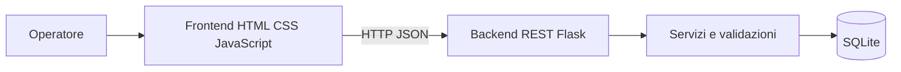
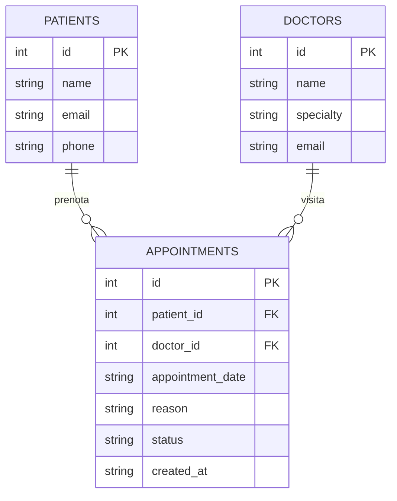
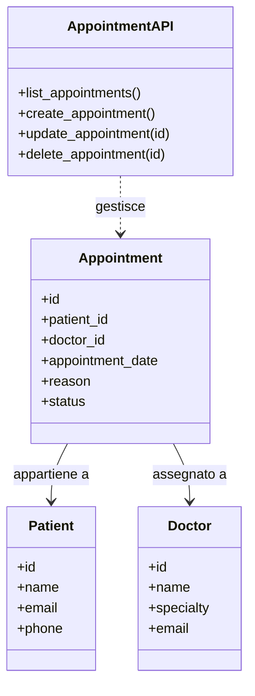

# Architettura e progettazione MediPlus

## Scenario organizzativo
MediPlus è un centro medico fittizio che vuole semplificare la pianificazione delle visite. Il personale amministrativo consulta gli appuntamenti, registra una nuova prenotazione e aggiorna lo stato. Il prototipo usa esclusivamente dati sintetici.

## Architettura logica

## Modello ER

## Classi / responsabilità

## Principali regole di business
1. Paziente, medico, data/ora e motivo sono obbligatori.
2. La visita deve essere programmata nel futuro.
3. Il paziente e il medico devono esistere.
4. Un medico non può avere due appuntamenti non annullati allo stesso orario.
5. Lo stato è uno tra Prenotata, Confermata, Completata e Annullata.

## Note progettuali
Le route Flask costituiscono il livello API; le funzioni di validazione applicano le regole di business e SQLite conserva i dati. Per un progetto di produzione è consigliato separare API, servizi e repository in moduli distinti, aggiungere autenticazione, logging e migrazioni.
